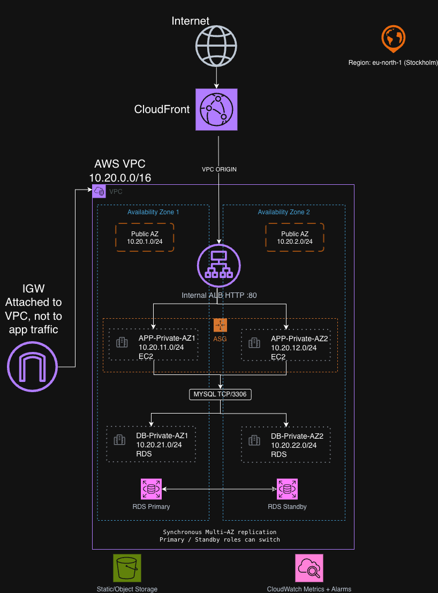

# Terraform AWS High Availability Web Application

A highly available AWS web application built entirely with **Terraform**, deployed across multiple Availability Zones and designed with private application and database tiers.

This project rebuilds and improves my previous manually deployed AWS HA Web Application. The main architectural improvement is replacing the public Application Load Balancer with **CloudFront + VPC Origin + an internal ALB**, leaving CloudFront as the only public application entry point.

**Video walkthrough:** [YouTube Demo](https://youtu.be/1HMC-f9XhSE)

---

## Architecture
Internet
   │
   │ HTTPS
   ▼
CloudFront
   │
   │ VPC Origin
   ▼
Internal Application Load Balancer
   │
   │ HTTP :80
   ▼
Auto Scaling Group
├── EC2 - Private App Subnet AZ1
└── EC2 - Private App Subnet AZ2
   │
   │ MySQL :3306
   ▼
RDS MySQL Multi-AZ
├── Private DB Subnet AZ1
└── Private DB Subnet AZ2

Additional services:

- **CloudWatch** – dashboard, metrics and ALB health alarm
- **S3** – private encrypted object storage
- **Secrets Manager** – AWS-managed RDS master credentials



---

## Infrastructure

### Networking

The environment uses a custom VPC in `eu-north-1` with separate subnet tiers across two Availability Zones.

| Tier | AZ1 | AZ2 |
|---|---|---|
| Public | `10.20.1.0/24` | `10.20.2.0/24` |
| Application | `10.20.11.0/24` | `10.20.12.0/24` |
| Database | `10.20.21.0/24` | `10.20.22.0/24` |

The application and database workloads remain in private subnets.

---

## Security Design

Traffic is restricted between infrastructure tiers using Security Group references.


CloudFront
     ↓ TCP/80
Internal ALB
     ↓ TCP/80
Application EC2
     ↓ TCP/3306
RDS MySQL


The ALB Security Group accepts origin traffic from the AWS-managed CloudFront origin-facing prefix list rather than `0.0.0.0/0`.

EC2 instances have no public IP addresses and RDS is configured as non-publicly accessible.

---

## CloudFront & Private Origin

CloudFront provides the public application endpoint and HTTPS connection for users.


Viewer → CloudFront
HTTPS

CloudFront → VPC Origin → Internal ALB
HTTP :80


The ALB is internal and deployed into the private application subnets.

Caching is disabled for the demo application so requests continue through to the ALB and application tier.

---

## High Availability

The application tier uses an EC2 Auto Scaling Group across two Availability Zones.

Minimum: 2
Desired: 2
Maximum: 4


A target-tracking policy monitors average ASG CPU utilization and scales toward a configured CPU target.

The ALB performs HTTP health checks against:


/health


The RDS MySQL database uses Multi-AZ deployment with database subnets in two Availability Zones.

---

## Monitoring

CloudWatch provides infrastructure monitoring through a dedicated dashboard containing:

- ALB `HealthyHostCount`
- EC2 / ASG `CPUUtilization`
- RDS `CPUUtilization`

A CloudWatch alarm triggers when healthy ALB targets remain below `2`.

---

## Storage

A private S3 bucket is created through Terraform with:

- Block Public Access enabled
- SSE-S3 (`AES256`) encryption
- Terraform-managed `app-info.txt` object

---

## Infrastructure as Code

The infrastructure is separated into Terraform configuration files by responsibility:

```text
network.tf      VPC, subnets, route tables and IGW
security.tf     Security Groups and traffic rules
compute.tf      ALB, target group, EC2 Launch Template and ASG
cloudfront.tf   CloudFront distribution and VPC Origin
database.tf     RDS and DB subnet group
storage.tf      S3
monitoring.tf   CloudWatch dashboard and alarm
variables.tf    Configurable input values
outputs.tf      Infrastructure outputs
userdata.sh     EC2 application bootstrap
```

Terraform resource references are used to create implicit dependencies between infrastructure components instead of hardcoded resource IDs.

---

## Validation & Failure Testing

The deployed environment was tested beyond successful provisioning.

| Test | Result |
|---|---|
| Terraform configuration validation | Passed |
| Full Terraform deployment | Passed |
| CloudFront HTTPS endpoint | Passed |
| HTTP → HTTPS redirect | Passed |
| Direct public access to internal ALB | Blocked |
| CloudFront VPC Origin | Deployed |
| ALB target health | 2 healthy targets |
| EC2 instances across multiple AZs | Verified |
| Auto Scaling Group desired capacity | Verified |
| EC2 termination / automatic replacement | Passed |
| CloudWatch health alarm | Verified |
| CloudWatch dashboard | Verified |
| RDS Multi-AZ | Verified |
| RDS private networking | Verified |
| AWS-managed RDS secret | Verified |
| S3 private access and encryption | Verified |
| Terraform destroy | Verified |

---

## Troubleshooting & Lessons Learned

### Launch Template networking

When a Launch Template contains a `network_interfaces` block, Security Groups must be configured as part of that network interface configuration.

### Failed ALB health checks

The ALB initially reported unhealthy application targets.

EC2 system logs showed that the user-data script failed because a Bash heredoc closing `EOF` marker was malformed. The remainder of the script was treated as file content, preventing the systemd web service from being created and started.

Correcting the heredoc allowed the application service to start and the targets became healthy.

### Auto Scaling policy reference

The scaling policy initially referenced the Terraform resource label as though it were the AWS Auto Scaling Group name.

Using:


aws_autoscaling_group.app_asg.name


correctly connects the resources and also creates the Terraform dependency.

### CloudWatch dashboard

CloudWatch dashboard bodies require correctly nested JSON structures. Terraform `jsonencode()` was used to build the dashboard while retaining Terraform resource references.

### RDS credentials

Instead of storing a database password in Terraform configuration, RDS is configured with AWS-managed master credentials through Secrets Manager.

### CloudFront architecture

A key learning point was separating the two network connections:


User → CloudFront
CloudFront → Origin


The viewer communicates with CloudFront over HTTPS, while CloudFront communicates privately with the internal ALB over HTTP port 80 through the VPC Origin.

---

## Technologies Used

**Infrastructure as Code**

- Terraform
- HashiCorp AWS Provider

**AWS**

- VPC
- CloudFront
- Application Load Balancer
- EC2
- Auto Scaling
- RDS MySQL Multi-AZ
- S3
- CloudWatch
- Secrets Manager
- Security Groups
- Internet Gateway

**Application**

- Amazon Linux 2023
- Python HTTP server
- systemd
- Bash user data

---

## Cost & Cleanup

The environment is intended as a temporary lab and portfolio deployment.

Higher-cost components such as RDS Multi-AZ and the Application Load Balancer are deployed only for validation and testing.

After testing:


terraform destroy


removes the Terraform-managed infrastructure.

Terraform state files are excluded from the repository and should never be committed to source control.

---

## Key Takeaways

This project gave me practical experience with:

- Designing AWS infrastructure as reusable Terraform configuration
- Terraform resources, data sources, variables, outputs and dependencies
- Managing networking and security between multiple infrastructure tiers
- Deploying a private application architecture behind CloudFront
- High availability across multiple Availability Zones
- Auto Scaling and application health monitoring
- RDS Multi-AZ and managed credentials
- CloudWatch dashboards and alarms
- Debugging real Terraform, AWS and Linux bootstrap failures
- Deploying and destroying complete environments through Infrastructure as Code